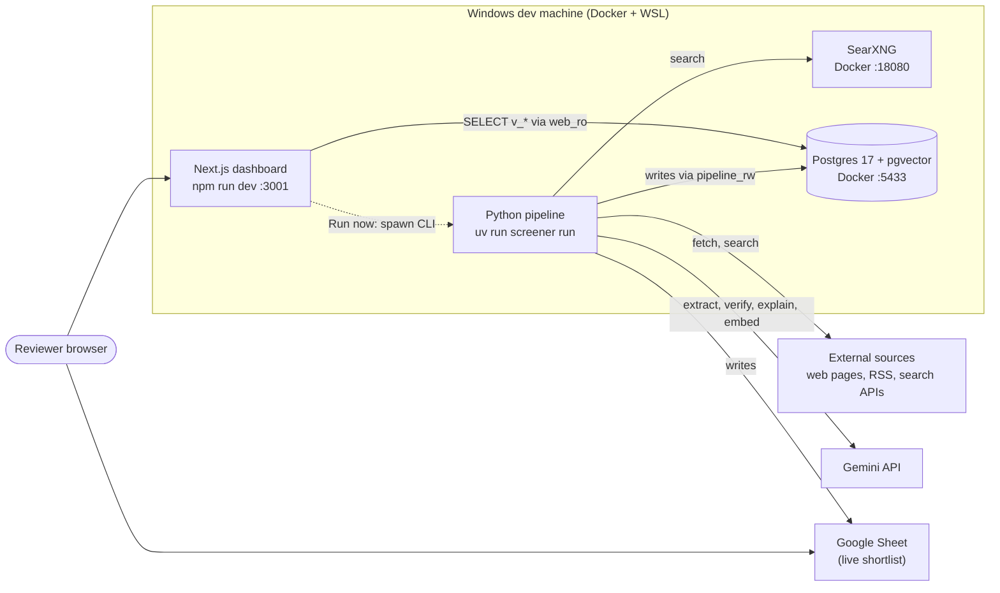
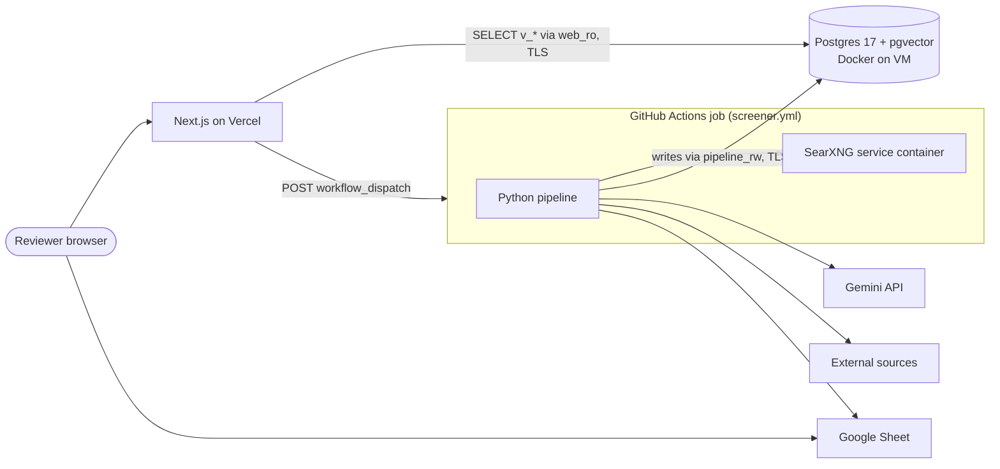
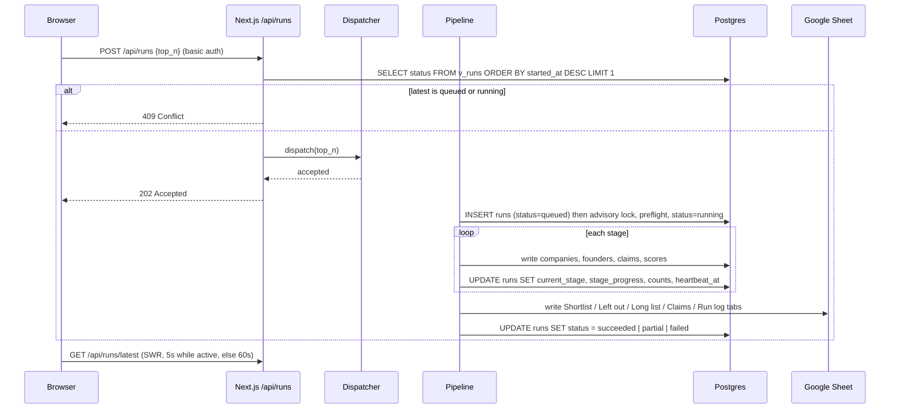

# Architecture

The single source of truth for how the pipeline, database, Google Sheet, GitHub Actions and the
dashboard connect. Every task follows this document. Engineering rules: [../CLAUDE.md](../CLAUDE.md).
Product rules and scoring: [SPEC.md](SPEC.md). Dashboard: [FRONTEND.md](FRONTEND.md), [BRAND.md](BRAND.md).

**One direction of data flow.** The pipeline writes; Postgres is the only shared state; the dashboard
reads `v_*` views and nothing else. The dashboard never calls the pipeline directly; it can only ask for
a run to be started (§6).

## Deployment phases

| | Phase 1: Local (now) | Phase 2: Hosted (later) |
|---|---|---|
| Postgres | `pgvector/pgvector:0.8.7-pg17` in Docker on the Windows dev machine | Same image, on an always-on host reachable over TLS (e.g. a small VM). Not Neon/Supabase. |
| SearXNG | Docker on the dev machine | Service container inside the GitHub Actions job |
| Pipeline | `uv run screener run` on the dev machine | GitHub Actions job (`.github/workflows/screener.yml`) |
| Dashboard | `npm run dev` in `/web` on the dev machine | Vercel, Root Directory = `web` |
| "Run now" | `RUN_DISPATCH_MODE=local`: API route starts the CLI as a local background process | `RUN_DISPATCH_MODE=github`: API route sends `workflow_dispatch` |
| Google Sheet | Same live Sheet in both phases | Same |

Moving from Phase 1 to Phase 2 changes connection strings, secrets and the dispatch mode only. The
schema, views, contracts and UI do not change.

Why the split: Vercel functions are short-lived with no Docker or persistent disk, so the long-running
crawl (SearXNG + Playwright + many LLM calls) can never run there. Vercel only displays data and triggers runs.

---

## 1. Component map

### Phase 1 (local)


### Phase 2 (hosted)


| Component | Responsibility | Runtime | Hosted (P1 → P2) | Can access |
|---|---|---|---|---|
| Python pipeline (`src/screener`) | Discover, resolve, enrich, verify, score, explain, publish | Python 3.12, uv, async httpx | Dev machine → GitHub Actions | Postgres (`pipeline_rw`), SearXNG, search APIs, public web (robots.txt-respecting), Gemini, Google Sheets API |
| Postgres + pgvector | The only shared state: tables, claims, scores, runs, `v_*` views | `pgvector/pgvector:0.8.7-pg17` | Docker on dev machine → Docker on VM | Nothing outbound |
| SearXNG | Self-hosted meta-search, first in the search router | `searxng/searxng` | Docker on dev machine → Actions service container | Public search engines |
| Google Sheet | Live shortlist for the upGrad team (the brief's deliverable) | Google Sheets | Google | Written by pipeline only (service account); reviewer label/note columns read back |
| Next.js dashboard (`/web`) | Display runs, shortlist, evidence; trigger runs | Node, Next.js 16 | Dev machine → Vercel | Postgres `v_*` views only (`web_ro`); GitHub dispatch API (P2) or local CLI spawn (P1) |
| GitHub Actions | Execute pipeline runs on demand or on schedule | `ubuntu-latest` runner | Phase 2 only | Repo secrets; everything the pipeline can access |

---

## 2. Backend tech stack (`/src`)

| Concern | Choice |
|---|---|
| Language / packaging | Python 3.12, uv (`pyproject.toml`, `uv.lock`) |
| CLI | Typer (`screener` entry point) |
| HTTP | httpx (async), per-domain rate limiter, on-disk cache under `.cache/` |
| Models | Pydantic v2 (domain models in `models.py`, view contracts in `contracts.py`) |
| Database | SQLAlchemy 2 + psycopg 3; **Alembic** migrations; pgvector (`pgvector` Python package) for embeddings |
| Extraction | trafilatura; Playwright (Chromium) fallback for JS pages; Jina Reader (`r.jina.ai`) last resort |
| LLM | `google-genai` SDK; model names from env/config only |
| Search | SearXNG (Docker) → ddgs → Exa → Tavily → SerpAPI → Gemini grounding, ordered by strategy (`config/providers.yaml`). Exa, Tavily and SerpAPI are called over their REST APIs with httpx (one async client, limiter, retry and logging path), not their SDKs. Each optional. |
| Embeddings | Gemini embeddings; fastembed (`BAAI/bge-small-en-v1.5`) CPU fallback |
| Stats / matching | numpy, scipy, scikit-learn, rapidfuzz, tldextract, unidecode, choix |
| Feeds | feedparser |
| Publishing | gspread + google-auth (service account) |
| Tests | pytest (SQLite allowed for pure-logic tests; fixtures only in `tests/fixtures/`) |

CPU only. No PyTorch, no GPU.

---

## 3. Frontend tech stack (`/web`)

| Concern | Choice |
|---|---|
| Framework | Next.js 16 (latest stable at time of writing: 16.4.3), App Router, React Server Components |
| Language | TypeScript, `strict: true` |
| Styling | Tailwind CSS v4 (CSS-first config: tokens mapped with `@theme` in `app/globals.css`), tokens from [BRAND.md](BRAND.md) |
| Components | shadcn/ui (Radix primitives), lucide-react icons |
| Tables | TanStack Table (Explore / long list) |
| Charts | Recharts (score bars, funnel, fit split) |
| Client data | SWR (run-status polling only) |
| Validation | zod at the DB boundary; types generated from `/contracts` (§5) |
| DB client | `postgres` (postgres.js), **server-side only** (`import "server-only"`). In Phase 2 the same driver connects to the Docker Postgres over TLS. |
| Hosting | Phase 1 `npm run dev`; Phase 2 Vercel with Root Directory = `web` |

---

## 4. Data contract: database views

The `v_*` views are the **only** thing the frontend reads. The backend owns them: they are created and
changed in Alembic migrations (`CREATE OR REPLACE VIEW`), never by hand and never by the frontend.

### 4.1 Run selection rule
- Every view carries `run_id` and `is_latest`.
- `is_latest = true` for rows of the **latest published run**: the most recent run with status
  `succeeded` or `partial` (a partial run completed its Publish stage with reduced coverage; its status
  pill says so).
- The frontend reads `WHERE is_latest` by default, or `WHERE run_id = $1` when a run is selected.

### 4.2 Views

**`v_shortlist`**: one row per shortlisted entity per run.

| Column | Type | Notes |
|---|---|---|
| run_id | uuid | |
| is_latest | bool | |
| rank | int | 1..15 |
| entity_id | uuid | company id |
| company | text | |
| website | text \| null | |
| founders | jsonb | `[{name, linkedin_url, role}]` |
| fit_type | text | `acquire` \| `partner` \| `co_build` |
| final | float | Final′ (after Bradley–Terry blend), 0–1 |
| t, i, f | float | Shrunk sub-scores, 0–1 |
| confidence | float | C, 0–1 |
| why_line | text | "Why they made the cut" |
| fit_line | text | "How they fit upGrad" |
| evidence | jsonb | `[{url, title, domain}]`, top 3 supported claims |
| last_verified | timestamptz | latest `retrieved_at` among supporting claims |
| reviewer_label | text \| null | synced back from the Sheet |
| region | text | `india` \| `outside` \| `unknown` (verified location, migration 0010) |
| region_basis | text | the evidence that decided the region (e.g. "evidence quote: Indore-based") |
| size_verified | bool | false = no verified funding or headcount behind the size check |

**`v_company_detail`**: one row per entity per run.

| Column | Type | Notes |
|---|---|---|
| run_id, is_latest | | |
| entity_id | uuid | |
| company, website, description | text | |
| country, city | text \| null | |
| founded_year | int \| null | |
| status | text | `active` \| `inactive` \| `unknown` |
| total_raised_usd | numeric \| null | |
| headcount | int \| null | |
| fit_type | text \| null | |
| rank | int \| null | null when not shortlisted |
| founders | jsonb | `[{founder_id, name, linkedin_url, role, is_current}]` |
| rounds | jsonb | `[{round_type, amount_usd, announced_on, investors, source_url}]` |
| score_breakdown | jsonb | `[{name, raw, adjusted, n_signals, pool_mean, weight, why_not_higher}]` for T, M, N, I, F_acquire, F_partner, F_co_build, F, C, final, bt_pct, final_prime |
| claims | jsonb | supported claims only: `[{field, value, source_url, evidence_span, retrieved_at, verifier_confidence}]` |
| region, region_basis | text | as in `v_shortlist` |

**`v_left_out`**

| Column | Type | Notes |
|---|---|---|
| run_id, is_latest | | |
| entity_id | uuid | |
| company | text | |
| founders | jsonb | `[{name, linkedin_url, role}]` |
| reason_code | text | `TOO_LARGE` \| `COMPETITOR` \| `UPGRAD_OWNED` \| `UNVERIFIABLE` \| `INACTIVE` \| `LOW_FIT` \| `NOT_EDUCATION` \| `DUPLICATE_THESIS` |
| explanation | text | |
| would_have_ranked | int \| null | rank by Final′ if the gate were ignored; null if never scored |
| source_url | text \| null | the claim that triggered the exclusion |
| region | text | as in `v_shortlist` |

**`v_long_list`**: top 200 per run by Final′.
Columns: `run_id, is_latest, rank, entity_id, company, website, founders, fit_type, final, t, m, n, i, f, f_acquire, f_partner, f_co_build, confidence, bt_pct, gate_status, reason_code, region`.

**`v_policy`** (migration 0013): one row per saved AI Policy version (`policy_versions`).
Columns: `version, status, author, note, policy, changes, created_at` (`status`: active / draft / superseded).
Writes go through `screener policy save|activate` (the CLI, never the dashboard role). The active version is
overlaid on `config/*.yaml` by `policy.effective_config` in score and explain; no saved version = YAML defaults.

**`v_search`** (migration 0012): one row per company, founder and MCA/DPIIT registry entry, for the search / ask box.
Columns: `kind, entity_id, company_id, name, company, website, description, location, region, shortlist_rank, rank,
fit_type, final, status, cin, registered_on, paid_up_capital_inr, authorized_capital_inr, total_raised_usd`.
Trigram indexes (`pg_trgm`, created by `screener db init`) keep substring search ~40 ms.

**Founder profiles** (migration 0011): the `founders` JSON in `v_shortlist` / `v_company_detail` adds `founder_id,
title, identity_verified, x_url, background [{field, value, source_url}], line`; `v_left_out` adds `featured,
featured_category, featured_line, description`; `v_shortlist` adds `description`.

The dashboard's India / Global switch (`?region=india|global`, India by default) filters these rows client-side.

**`v_runs`**

| Column | Type | Notes |
|---|---|---|
| run_id | uuid | |
| status | text | `queued` \| `running` \| `succeeded` \| `failed` \| `partial` |
| current_stage | text \| null | `discover` \| `resolve` \| `enrich` \| `verify` \| `score` \| `explain` \| `publish` |
| stage_progress | float | 0–1 within the current stage |
| trigger | text | `cli` \| `dashboard` \| `schedule` |
| started_at, finished_at, heartbeat_at | timestamptz | |
| counts | jsonb | `{candidates, companies, founders, claims_supported, shortlisted}` |
| provider_usage | jsonb | `{<provider>: {calls, errors, cost_usd, quota_used, quota_limit}}` |
| cost_usd | numeric | |
| error_summary | text \| null | |
| config_snapshot | jsonb | `{weights, gap_map, exclusions, models}` used for this run |
| sheet_url | text \| null | |
| is_latest | bool | latest published run |

A run whose status is `running` but whose `heartbeat_at` is older than 15 minutes is reported by the
view as `failed` with `error_summary = 'stale: no heartbeat'`.

**`v_funnel`**: `run_id, is_latest, stage, stage_order, count`. Stages in order:
`discovered → resolved → enriched → verified → gated → scored → shortlisted`.

### 4.3 Rules
- Views always default to the latest published run (§4.1) unless a `run_id` is passed.
- The backend owns the views; they live in Alembic migrations under `src/screener/migrations/`.
- The frontend connects as `web_ro`, which has `SELECT` on `v_*` views only. Views are created by the
  migration owner without `security_invoker`, so `web_ro` needs no table privileges.
- Every migration that creates or replaces a view re-issues `GRANT SELECT ON <view> TO web_ro`.
- Changing a view's columns is a contract change (§5).

---

## 5. Shared types

```
Postgres v_* view  ⇄  src/screener/contracts.py (Pydantic)  →  contracts/*.json (JSON Schema)
                                                             →  web/lib/contracts.ts (generated TS)
                                                             →  web/lib/schemas.ts (zod, hand-written, mirrors TS)
```

1. Pydantic models for every view row live in [`src/screener/contracts.py`](../src/screener/contracts.py).
   Field names and types match §4 exactly.
2. `uv run screener export-schema` writes one JSON Schema per model to `/contracts/*.json`.
3. `npm run gen:types` in `/web` runs json-schema-to-typescript over `/contracts/*.json` and writes
   `web/lib/contracts.ts`. Never edit that file by hand.
4. The frontend validates every row with zod at the boundary (`web/lib/schemas.ts`), typed against the
   generated types (`z.ZodType<ShortlistRow>`) so drift fails `tsc`.
5. A backend test asserts each view's column set equals its Pydantic model's fields.
6. Whenever a view changes: update the migration, `contracts.py`, run `export-schema` and `gen:types`,
   and commit all of them in the same PR. See [`contracts/README.md`](../contracts/README.md).

---

## 6. Control flow: "Run now"



**Dispatcher, selected by `RUN_DISPATCH_MODE`:**

| Mode | Phase | What `POST /api/runs` does |
|---|---|---|
| `local` | 1 | Spawns `uv run screener run --top-n <n> --trigger dashboard` as a detached child process with `cwd = SCREENER_REPO_DIR`. Refused unless the server is on the dev machine (`NODE_ENV=development` or `ALLOW_LOCAL_DISPATCH=true`). |
| `github` | 2 | `POST https://api.github.com/repos/{GITHUB_REPO}/actions/workflows/screener.yml/dispatches` with body `{"ref": GITHUB_REF, "inputs": {"top_n": "<n>"}}`, header `Authorization: Bearer $GITHUB_DISPATCH_TOKEN` (fine-grained PAT, *Actions: write*, this repo only). GitHub returns 204. |

**Guards against double runs:**
1. API: 409 if the latest `v_runs` row is `queued` or `running`.
2. GitHub mode: the API also lists workflow runs with `status=queued|in_progress` for `screener.yml` and
   returns 409 if any exist (covers the gap before the job inserts its `runs` row). The workflow sets
   `concurrency: {group: screener, cancel-in-progress: false}`.
3. Pipeline: takes a Postgres advisory lock at start; a second process marks its own row `failed`
   ("another run in progress") and exits.

**Polling and caching:** the client polls `GET /api/runs/latest` with SWR, `refreshInterval` 5000 ms while
the status is `queued` or `running`, otherwise 60000 ms. Server components use `export const revalidate = 60`.
When a polled run changes to a final status, the client calls `router.refresh()`.

**Routes** (all behind basic auth): `POST /api/runs`, `GET /api/runs/latest`, `GET /api/runs/[runId]`,
`GET /api/shortlist.csv`.

---

## 7. Live progress

The pipeline writes a checkpoint to `runs` at every stage boundary, and at least every 30 s inside long
stages: `current_stage`, `stage_progress` (items done / items planned), `counts`, `provider_usage`,
`heartbeat_at`. It also writes `v_funnel` source counts as each stage completes.

The dashboard shows a stage stepper:

**Discover → Resolve → Enrich → Verify → Score → Explain → Publish**

Each step is: done (check), active (spinner + progress bar from `stage_progress`), pending, or failed
(with `error_summary`). A partial run shows the stage where the budget guard stopped it.

---

## 8. Secrets and environments

**Rule:** the Google service-account JSON, LLM keys and search keys never go to Vercel. Vercel gets only
`DATABASE_URL_RO`, dashboard auth, the Sheet URL and the dispatch token. Real values live in `.env`
(git-ignored) locally. **Backend and frontend never share an env file:**

| File (git-ignored) | Template | Holds |
|---|---|---|
| `.env` | `.env.example` | Backend + Postgres container |
| `web/.env.local` | `web/.env.example` | Dashboard only |
| `docker/searxng/.env` | `docker/searxng/.env.example` | `SEARXNG_SECRET` only (the SearXNG container) |

| Variable | Used by | Local (`.env`) | GitHub Secrets | Vercel |
|---|---|---|---|---|
| `POSTGRES_USER`, `POSTGRES_PASSWORD`, `POSTGRES_DB`, `POSTGRES_HOST_PORT` | Postgres container (superuser, init only; host port default 5433) | ✓ | | |
| `PIPELINE_RW_PASSWORD`, `WEB_RO_PASSWORD` | Postgres init script (creates roles) | ✓ | | |
| `DATABASE_URL` | Pipeline, Alembic (`pipeline_rw`) | ✓ | ✓ | |
| `DATABASE_ADMIN_URL` | `screener db init` only: creates/syncs roles (superuser) | ✓ | | |
| `DATABASE_URL_RO` | Dashboard (`web_ro`) | ✓ (`web/.env.local`) | | ✓ |
| `GEMINI_API_KEY` | Pipeline | ✓ | ✓ | |
| `GEMINI_MODEL_FAST`, `GEMINI_MODEL_SMART`, `GEMINI_EMBED_MODEL` | Pipeline | ✓ | ✓ (vars) | |
| `SEARXNG_URL` | Pipeline | ✓ | set in workflow | |
| `SEARXNG_SECRET` | SearXNG container | ✓ (`docker/searxng/.env`) | ✓ | |
| `EXA_API_KEY`, `TAVILY_API_KEY`, `SERPAPI_API_KEY`, `JINA_API_KEY` | Pipeline (each optional) | ✓ | ✓ | |
| `GOOGLE_SERVICE_ACCOUNT_JSON` | Pipeline: path to the service-account JSON (outside the repo) **or** the JSON inline | ✓ (path) | ✓ (inline JSON) | |
| `GOOGLE_SHEET_ID` | Pipeline | ✓ | ✓ | |
| `GOOGLE_SHEET_URL` | Dashboard ("Open Google Sheet") | ✓ (`web/.env.local`) | | ✓ |
| `USER_AGENT_CONTACT` | Pipeline: contact in the crawler UA `upGradFounderScreener/<ver> (research crawler; contact: …)` | ✓ | ✓ (vars) | |
| `GITHUB_TOKEN`, `PRODUCTHUNT_TOKEN`, `PDL_API_KEY` | Pipeline enrichment (later stages; each optional) | ✓ | ✓ | |
| `RUN_BUDGET_USD`, `RUN_MAX_LLM_CALLS` | Pipeline budget guard | ✓ | ✓ (vars) | |
| `LOG_LEVEL` | Pipeline | ✓ | ✓ (vars) | |
| `DASHBOARD_USER`, `DASHBOARD_PASSWORD` | Dashboard basic auth | ✓ (`web/.env.local`) | | ✓ |
| `RUN_DISPATCH_MODE` | Dashboard (`local` \| `github`) | `local` | | `github` |
| `SCREENER_REPO_DIR` | Dashboard, local dispatch | ✓ | | |
| `GITHUB_DISPATCH_TOKEN`, `GITHUB_REPO`, `GITHUB_REF` | Dashboard, github dispatch | | | ✓ |

**Postgres roles**

| Role | Privileges | Used by |
|---|---|---|
| `postgres` (superuser) | Everything | Container init only; never by the app |
| `pipeline_rw` | Owns schema `public` objects; runs Alembic; read/write all tables; creates views | Pipeline (local + Actions) |
| `web_ro` | `CONNECT`, `USAGE` on schema, `SELECT` on `v_*` views only. `default_transaction_read_only = on`. | Dashboard (local + Vercel) |

Roles are created by `docker/postgres/init/01-roles.sh` on first container start, and created or synced
idempotently by `uv run screener db init` when `DATABASE_ADMIN_URL` is set (it also ensures the `vector`
extension and schema ownership). Grants on views are issued by migrations. `db init` then runs Alembic as
`pipeline_rw`. On SQLite (tests) it only creates tables.

---

## 9. Failure modes

| Failure | Behaviour |
|---|---|
| Search/fetch provider down or 5xx | Router falls back to the next provider; call logged in `api_calls` with status and latency; the run continues. |
| One source page fails / blocked by robots.txt | Skipped and logged; never crashes the run. |
| Provider quota near limit | Budget guard (per-provider quota + `RUN_BUDGET_USD` / `RUN_MAX_LLM_CALLS`) stops the current stage; remaining stages run on what exists; run marked `partial` with the reason in `error_summary`. |
| LLM returns invalid JSON | One retry with a repair prompt; then the item is skipped and logged. |
| Google Sheet 429 / 5xx | Exponential backoff with jitter (max 6 tries); batch writes. If the Sheet still fails, DB results stand and the run is `partial`. |
| DB unreachable at start | Preflight fails fast with a clear message (`DATABASE_URL` host, error); no work is done. |
| DB lost mid-run | Run aborts, exit code non-zero; status set to `failed` on reconnect if possible, else the stale-heartbeat rule marks it failed. |
| Pipeline crash | A stage error is caught by the orchestrator (stage `failed`, run `partial`/`failed`); a standalone `score` / `rescore` marks its own run `failed` with the error. A hard kill leaves `running`: `v_runs.stale` is true after 15 min without a heartbeat, and the dashboard stops treating the run as active after 60 min (so "Run now" and re-score are not blocked forever). |
| Gemini unavailable during scoring (quota, spend cap) | Embeddings switch to fastembed for the whole run; if the pairwise judge answers fewer than `pairwise.min_answered_share`, the newest scored run's Bradley-Terry percentiles are reused; explanations use cached text or claim templates. The run still publishes; the log says so. |
| Dashboard-launched process (Run now, re-score) | Output goes to `.cache/logs/dashboard-*.log`, ending with `[dashboard] process exited with code N` (or the spawn error). |
| Dashboard: missing/null fields, empty views | zod schemas use `.nullable()` for nullable columns; invalid rows are dropped and logged server-side, not thrown. Every page has empty and error states; nothing crashes on missing data. |
| Dashboard: DB unreachable | Error state with retry; the "Open Google Sheet" link still works. |
| Dispatch fails (GitHub 4xx/5xx, spawn error) | API returns 502 with a readable message; UI shows a toast and re-enables the button. |

---

## 10. Local development

### Prerequisites
Docker Desktop (WSL 2 backend), uv, Node.js 20+ (LTS), Git.

### 10.1 Configure
```powershell
# PowerShell
Copy-Item .env.example .env                                   # backend; fill in real values
Copy-Item docker\searxng\.env.example docker\searxng\.env   # SEARXNG_SECRET
Copy-Item web\.env.example web\.env.local                     # dashboard
```
```bash
# bash
cp .env.example .env
cp docker/searxng/.env.example docker/searxng/.env
cp web/.env.example web/.env.local
```

### 10.2 Start Postgres + SearXNG (`docker-compose.yml`)
```powershell
docker compose up -d                                        # Postgres + SearXNG (included)
docker compose -f docker/searxng/docker-compose.yml up -d   # SearXNG alone
docker compose ps
```
```bash
docker compose up -d
docker compose -f docker/searxng/docker-compose.yml up -d
docker compose ps
```
Ports are bound to `127.0.0.1` only: Postgres on host port **5433** (`POSTGRES_HOST_PORT`; 5432 is often
taken by a native Postgres install), SearXNG on host port **18080** (`SEARXNG_HOST_PORT`; Windows/Hyper-V can reserve 8027-8126 after a restart). Data persists in the `pgdata` volume. Both files use
project name `upgrad-screener`, so starting SearXNG alone prints a harmless "orphan containers" warning.
Roles `pipeline_rw` and `web_ro` are created on the first start of an empty volume.

### 10.3 Backend
```powershell
uv sync
uv run playwright install chromium
uv run screener db init           # roles (DATABASE_ADMIN_URL) + tables + v_* views + grants
uv run screener doctor            # enabled / working / quota left per provider
uv run screener run --top-n 15    # (later task)
```
```bash
uv sync
uv run playwright install chromium
uv run screener db init
uv run screener doctor
uv run screener run --top-n 15
```

### 10.4 Dashboard
```powershell
cd web; npm install; npm run gen:types; npm run dev
```
```bash
cd web && npm install && npm run gen:types && npm run dev
```
`web/.env.local` uses `DATABASE_URL_RO=postgresql://web_ro:<pw>@localhost:5433/screener` and
`RUN_DISPATCH_MODE=local`.

### 10.5 Useful checks
```powershell
docker compose exec postgres psql -U web_ro -d screener -c "select * from v_runs limit 1"
Invoke-RestMethod "http://localhost:18080/search?q=edtech+india&format=json" | Select-Object -ExpandProperty results | Select-Object -First 3
```
```bash
docker compose exec postgres psql -U web_ro -d screener -c "select * from v_runs limit 1"
curl -s "http://localhost:18080/search?q=edtech+india&format=json" | head -c 500
```

### 10.6 Phase 2 checklist (later)
Provision a host for the Postgres container with TLS and a firewall, set `sslmode=require` in both URLs,
add GitHub Secrets/Vars from §8, add `.github/workflows/screener.yml` (SearXNG as a service container,
`concurrency` group), set Vercel env vars, switch `RUN_DISPATCH_MODE=github`.
